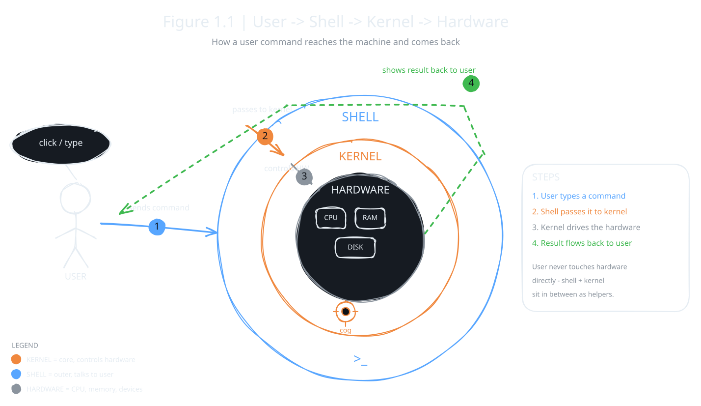

An operating system is not one big block of code. It is made of many parts, and each part has its own job. Think of a school. It has different departments, but they all work together so the school runs smoothly. An OS works the same way.

:::definition{source="Computer Science and Entrepreneurship 10 (PECTAA), topic 1.2"}
The architecture of an operating system is the way how its parts are organized and how they work together.
:::

## Kernel vs Shell

Every OS has two main parts: an inner part called the kernel and an outer part called the shell.

### Kernel

The kernel is the heart of the OS. It is hidden from you, but it does the real work. It talks to the CPU, the memory and every device. It also decides which program can use these resources, and when.

:::definition{source="Computer Science and Entrepreneurship 10 (PECTAA), topic 1.2"}
The kernel is the core part of the operating system, that directly controls the computer's system software and hardware such as the CPU, memory, and devices, as shown in Figure 1.1. It decides how and when different programs can use these resources.
:::

:::example
You open a file. The kernel reads it from the hard drive and sends it to the screen. You never see the kernel at work, you only see the result.
:::

### Shell

The shell is the part you actually see and use. It takes your command and passes it to the kernel.

:::definition{source="Computer Science and Entrepreneurship 10 (PECTAA), topic 1.2"}
The shell is the outer part of the OS that interacts with the user.
:::

Shells come in two kinds:

| Shell type | How you use it | Example |
|---|---|---|
| Graphical shell | Click icons and use menus | Windows desktop |
| Command-line shell | Type instructions | Command Prompt or Terminal |

The book compares this to a car. The engine is the kernel. The steering wheel and dashboard are the shell. The driver only touches the shell, but the engine does the work.

The picture below shows Figure 1.1 as a hand-drawn diagram. Your command goes inward from you, to the shell, to the kernel, to the hardware. The result comes back out to you.

## OS Layers and Modular Design

The OS is also built in **layers**, like the floors of a building. Each layer has a specific job:

- **Lower layer:** works directly with hardware, like the CPU, RAM, storage and hard drive.
- **Middle layer:** manages these resources so programs can use them when needed.
- **Upper layer:** runs applications and shows the interface you see on the screen.

Each layer depends on the one below it. Because of this design, the OS is easier to manage, repair and improve. You can fix one layer without changing the whole system.

:::example
A school works in layers too. Support staff, like guards and cleaners, keep the school ready (the lower layer). The administration manages resources, schedules and rules (the middle layer). The instructor and the students use all of this to teach and learn (the upper layer).
:::

## System Libraries and Device Drivers

The OS gives programs two kinds of helpers.

:::definition{source="Computer Science and Entrepreneurship 10 (PECTAA), topic 1.2"}
System libraries are collections of ready-made instructions that programs can use to perform common tasks, such as opening files or showing text on the screen.
:::

Because of libraries, every app does not need to write the same code again. A photo editing app uses the OS library to open an image. It does not build its own way to open pictures.

:::definition{source="Computer Science and Entrepreneurship 10 (PECTAA), topic 1.2"}
Device drivers are special programs that allow the operating system to communicate with hardware devices such as printers, keyboards, and graphics cards.
:::

:::did-you-know
Every Android phone is a layered OS. The Linux kernel sits at the bottom, and the app you tap sits on top.
:::
