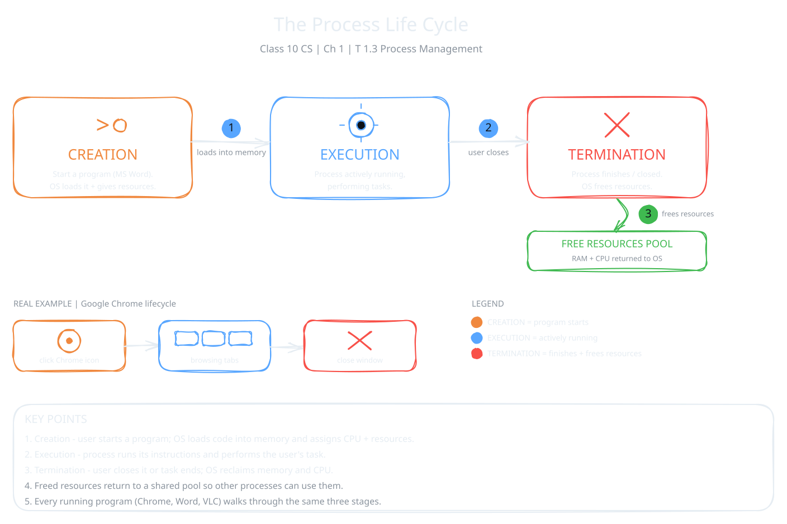

Every program you open needs memory and CPU time to run. The OS looks after all of these running programs, so each one gets what it needs. This job is called process management. It is one of the most important jobs of an OS, because it stops programs from disturbing each other.

:::definition{source="Computer Science and Entrepreneurship 10 (PECTAA), topic 1.3"}
The operating system is responsible for managing all the programs that run on a computer. In this context, these running programs are called processes.
:::

## Process Life Cycle

Every process passes through three stages:

1. **Creation:** you start a program, like MS Word. The OS loads it into memory and gives it the resources it needs, like CPU time and memory.
2. **Execution:** the process is running and doing its work.
3. **Termination:** the process finishes, or the user or system closes it. The OS takes back its resources, so other processes can use them.

:::example
Think of Google Chrome. **Creation** starts when you click its icon, and the OS loads it into memory. During **execution**, Chrome loads web pages, plays media and responds to your clicks. **Termination** happens when you close it, and the OS frees its resources.
:::

## Multitasking and Concurrency

A modern OS makes many processes seem to run at the same time. Two ideas explain this.

**Multitasking** means one user can keep more than one program open and usable at the same time. You can switch between them whenever you like. For example, you listen to music, keep a document open and browse the internet.

**Concurrency** means more than one process is active at the same time, but the CPU works on them one by one, in very fast turns.

:::example
A chef cooks three dishes. She works on one for a short time, then moves to the next, and repeats. The CPU does the same with processes. It switches so fast that you never notice a delay.
:::

## Process Scheduling Concepts

The CPU can work on only one process at a time. So the OS must decide two things:

- Which process should run first?
- How long should each process run?

This decision is called **scheduling**. There are many scheduling methods. This book covers one of the simplest: **First Come, First Served (FCFS)**.

:::definition{source="Computer Science and Entrepreneurship 10 (PECTAA), topic 1.3"}
In the FCFS method, the CPU processes tasks in the exact order they arrive. The first process to arrive is completed first, and the next process starts only after the previous one finishes.
:::

FCFS works like a queue at a shop counter. The first customer in line is served first.

### Numerical Example

Three processes arrive at the CPU:

| Process ID | Arrival Time | Time Needed | Starts | Finishes |
|---|---|---|---|---|
| P1 | 0 seconds | 5 seconds | 0s | 5s |
| P2 | 1 second | 3 seconds | 5s | 8s |
| P3 | 2 seconds | 2 seconds | 8s | 10s |

P1 arrives first and runs from 0s to 5s. P2 arrives at 1s and waits. P3 arrives at 2s and waits behind both. P2 runs from 5s to 8s, then P3 runs from 8s to 10s.

Look at P3. It needs only 2 seconds, the shortest time of all. But it still waits, because P1 and P2 arrived first.

:::tip
Some exam questions ask for **waiting time**: start time minus arrival time. Here, P1 waits 0 seconds, P2 waits 4 seconds (5 minus 1) and P3 waits 6 seconds (8 minus 2).
:::

### Advantages and Disadvantages of FCFS

| Advantages | Disadvantages |
|---|---|
| Easy to understand and implement | Short processes may wait a long time behind longer ones |
| Processes are served in the exact order they arrive. No process is skipped. | This "convoy effect" can affect the overall efficiency of the system |

:::did-you-know
Your computer's CPU can switch between processes millions of times in one second. That is why you can play music, browse the web and download files all at once.
:::
