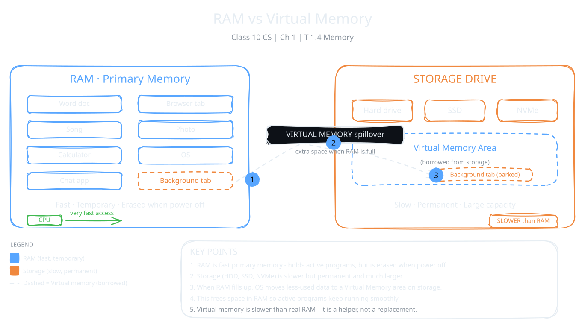

The CPU needs a place to keep the data and instructions it is working on. That place is memory. It lets the CPU get information quickly while a program runs. In this topic you will meet two kinds: primary memory (RAM) and virtual memory.

:::definition{source="Computer Science and Entrepreneurship 10 (PECTAA), topic 1.4"}
Memory is a fundamental component of a computer system, used to store data and instructions required for processing. It ensures that the CPU can access information quickly during program execution.
:::

## Primary Memory (RAM)

RAM is the computer's main working area. It is very fast. But it only keeps data for a short time, so we call it temporary. When you switch off the computer, everything in RAM is lost.

:::definition{source="Computer Science and Entrepreneurship 10 (PECTAA), topic 1.4"}
Primary memory, also called Random Access Memory (RAM), is the main working area of a computer. It is a fast storage area where the computer keeps the data and instructions temporarily. Its data is erased when the computer is turned off.
:::

:::example
You open a Word document. The computer quickly copies the Word program and your document into RAM. Now the CPU can start working on them right away.
:::

## Virtual Memory

RAM has a limit. What happens when it is full? The OS borrows some space from the storage drive and uses it as extra RAM. This borrowed space is called **virtual memory**. The storage drive can be a hard drive, a solid-state drive (SSD) or a Non-Volatile Memory Express (NVMe) drive.

With virtual memory, you can run more programs at the same time. But there is a cost. Storage drives move data more slowly than RAM. They also take longer to reach the data. So when the OS uses virtual memory, the whole system can become slower.

Suppose you have many programs open. The OS may move data from the programs you are not using right now into virtual memory. This frees space in RAM for the programs you are actively using. The downside: those less active programs may respond more slowly when you go back to them.

:::example
You are writing a document while a browser tab sits in the background. The OS can park that background tab in virtual memory. Your document stays in fast RAM. When you click the old tab again, it may take a moment to wake up.
:::

### RAM vs Virtual Memory

| | RAM | Virtual Memory |
|---|---|---|
| What it is | Main working area of the computer | Part of the storage drive used as extra RAM |
| Speed | Fast | Slower |
| When it is used | Always, for running programs | When RAM is full |
| Effect | Programs run quickly | More programs can run, but performance drops |

:::tip
Remember it this way: virtual memory is a helper for RAM, not a replacement. It gives you more space, but never more speed.
:::

:::did-you-know
The first personal computer, the IBM 5150 from 1981, had only 16 KB of RAM. Today's DDR5 RAM can move more than 50 GB of data per second. That is fast enough to copy a full HD movie in under one second.
:::
