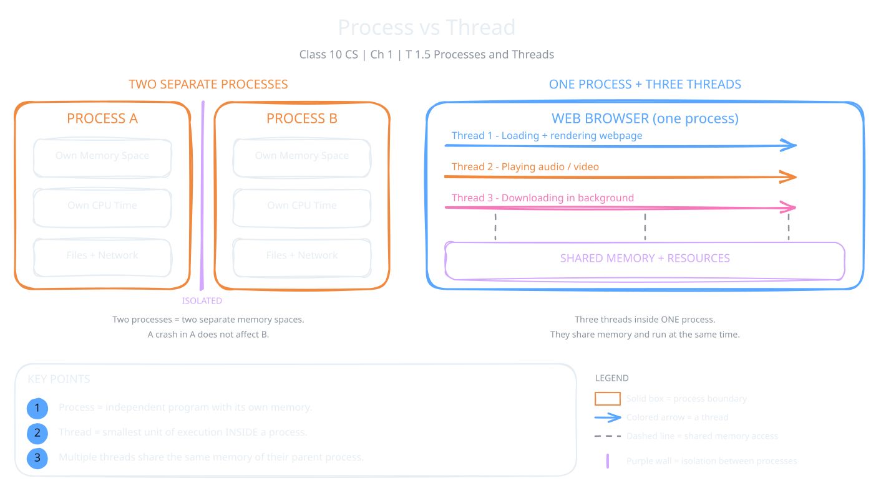

In topic 1.3 you learned that a running program is called a process. Now we look inside a process. One process can do many jobs at once, using small workers called threads. This topic explains how processes and threads differ, and why threads make programs feel fast.

:::definition{source="Computer Science and Entrepreneurship 10 (PECTAA), topic 1.5"}
A process is an independent program that is currently being executed by the computer.
:::

Every process gets its own memory space, its own share of CPU time and its own resources, such as files or network connections. Processes are kept apart from each other. This keeps the computer stable and secure. If one process has a problem, the others usually keep running.

:::definition{source="Computer Science and Entrepreneurship 10 (PECTAA), topic 1.5"}
A thread, on the other hand, is the smallest unit of execution within a process.
:::

A "unit of execution" is one piece of work that the CPU can run. One process can hold many threads. Each thread does a different task. All threads of a process share the same memory and resources, but each one runs on its own.

:::example
Think of a web browser. The whole browser is **one process**. Inside it, different **threads** do different jobs:

- One thread loads and shows a webpage.
- A second thread plays audio or video.
- Another thread downloads files in the background.

Thanks to these threads, the browser can load new pages while a video keeps playing. You do not wait for one job to end before the next one starts.
:::

| | Process | Thread |
|---|---|---|
| What it is | An independent running program | The smallest unit of execution inside a process |
| Memory | Has its own memory and resources | Shares the memory and resources of its process |
| Isolation | Kept apart from other processes | Works together with other threads in the same process |
| Cost | Heavier, needs its own resources | Lighter, reuses its parent process's resources |

## Multithreading

Multithreading is a way to split one process's work into many threads. Each thread runs on its own, but they all share the process's memory and resources. The result is faster work, quicker response and less waste.

:::definition{source="Computer Science and Entrepreneurship 10 (PECTAA), topic 1.5"}
Multithreading is an operating system technique that allows a single process to perform multiple tasks at the same time by dividing its work into smaller units called threads.
:::

## Benefits of Multithreading

The book names four main benefits:

1. **Enhanced Performance:** a big task is split across many threads that run in parallel. So complex work finishes sooner.
2. **Improved Responsiveness:** the app keeps responding, even while one thread is busy. In a word processor, you keep typing while another thread checks your spelling in the background.
3. **Support for Concurrent (parallel) Operations:** many tasks can move forward in the same period. This matters a lot in games, video editing and real-time communication tools.
4. **Efficient Use of Resources:** threads share their parent process's memory and resources. So they need fewer system resources than separate processes.

:::example
In a video game, one thread can run the physics, one can control the enemies, one can draw the screen and one can play the music. They all work at the same time.
:::

:::tip
A simple way to remember: a process is a house, and threads are the people living in it. They share the same rooms, but each person does a different job.
:::
