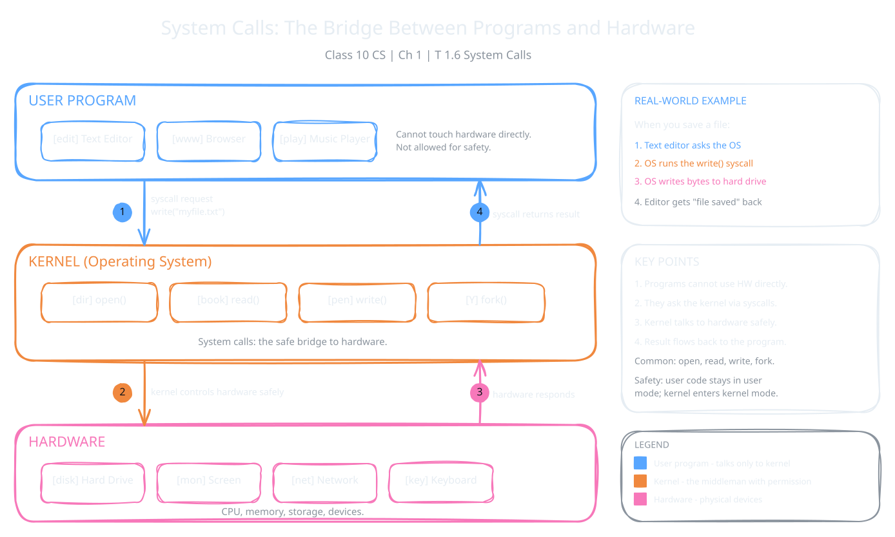

Your apps cannot touch the hard drive, the screen or the keyboard by themselves. They must ask the operating system for help. This request is called a system call. In this topic, you will learn what a system call is, why it is needed, and the four main types.

:::definition{source="Computer Science and Entrepreneurship 10 (PECTAA), topic 1.6"}
A system call is a request made by a program to the operating system to perform a specific task that the program cannot do directly.
:::

Think of a system call as a bridge. On one side are user programs, like a text editor or a music player. On the other side is the kernel, the core of the OS that controls the hardware. A program crosses this bridge to use the hardware and the main OS functions in a safe way.

Why not let programs control the hardware directly? Because that would be unsafe and complex. A small mistake in one app could harm the whole computer. Also, every app would need to know how every printer or disk works. With system calls, the kernel does this risky work, and programs only ask.

:::example
You click **Save** in a text editor. The editor does not write to the hard drive itself. It makes a system call, asking the OS to write the data to the storage drive. The OS does the writing and then tells the editor the file is saved.
:::

A system call is a round trip with four steps:

1. The program sends a request to the kernel.
2. The kernel controls the hardware safely.
3. The hardware does the job and responds.
4. The kernel returns the result to the program.

## Types of System Calls

The book lists four main types of system calls:

| System call | What it does | Example |
|---|---|---|
| **open** | Opens a file for reading or writing. | Opening a music file to play. |
| **read** | Retrieves data from a file or input device. | Reading text from a document. |
| **write** | Sends data to a file or output device. | Saving an image to the computer. |
| **fork** | Creates a new process by duplicating an existing one. | Opening a new browser tab, where the OS may use fork to create another process. |

"Retrieves" means gets back. "Duplicating" means making a copy. So fork makes a copy of a running process to start a new one.

:::tip
Notice the pattern: open, read and write all deal with files and devices. Fork is the odd one out. It deals with processes, which you studied in topic 1.3.
:::

:::did-you-know
Linux and macOS have a few hundred system calls. Windows has nearly 2,000. They handle everything from opening files to running apps and showing graphics, all in the background while you work.
:::
