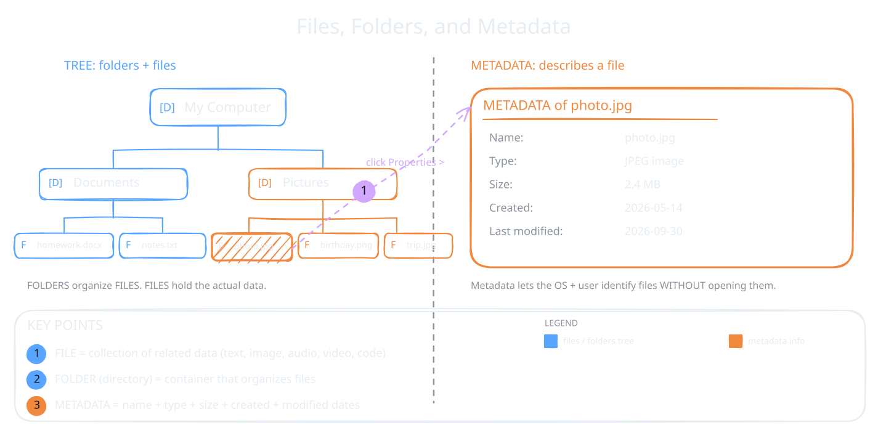

An operating system does more than run programs. It also stores and organizes your data. Your computer may hold thousands of files. The OS keeps all of them organized, safe and easy to find. The part of the OS that does this is the **file system**.

## Files

Everything you save on a computer is kept as a file. A file can hold text, a picture, a song, a video or even the instructions of a program.

:::definition{source="Computer Science and Entrepreneurship 10 (PECTAA), topic 1.7"}
A **file** is a collection of related data stored on a computer. It may contain text, images, audio, video, or program instructions.
:::

## Folders

Folders group related files together. A folder can also hold other folders inside it. This builds a tree, so you can find things quickly.

:::definition{source="Computer Science and Entrepreneurship 10 (PECTAA), topic 1.7"}
A **folder** (also called a **directory**) is a container used to organize files and other folders in a logical structure, making it easier to locate and manage information.
:::

## Metadata

Metadata is "data about data". It tells you about a file without opening it. When you right-click a file and open its properties, you see its metadata.

:::definition{source="Computer Science and Entrepreneurship 10 (PECTAA), topic 1.7"}
**Metadata** refers to details about a file, folder, such as its name, type, size, date of creation, and date of last modification.
:::

Both you and the OS use metadata. It helps to identify and manage files and folders quickly.

## File Systems

A file system is the set of rules the OS uses to store files on a drive. It decides where each file goes. It also remembers that location, so the file can be found again later.

:::definition{source="Computer Science and Entrepreneurship 10 (PECTAA), topic 1.7"}
A file system is the way an operating system stores and organizes files on a storage device, such as a hard drive, SSD, or USB.
:::

Different operating systems use different file systems. The book names these four:

| File system | Where it is used |
|---|---|
| FAT 32 | USB flash drives |
| NTFS | Windows OS |
| APFS / HFS+ | macOS |
| EXT4 | Linux OS |

The file system you choose affects three things: performance (speed), storage capacity and security features.

:::example
A file system works like a librarian. The librarian places each book in the right section and remembers where it is. When you save a photo, the file system stores it in the right place. When you open the photo later, it knows exactly where to find it.
:::

:::did-you-know
FAT 32 cannot store a single file bigger than 4 GB. That is why a big movie file may not copy to an old FAT 32 USB drive, but it copies fine to an NTFS drive.
:::

:::tip
Files, folders and the file system work closely with system calls from topic 1.6. When an app opens, reads or writes a file, it asks the OS through a system call, and the file system finds the data.
:::
