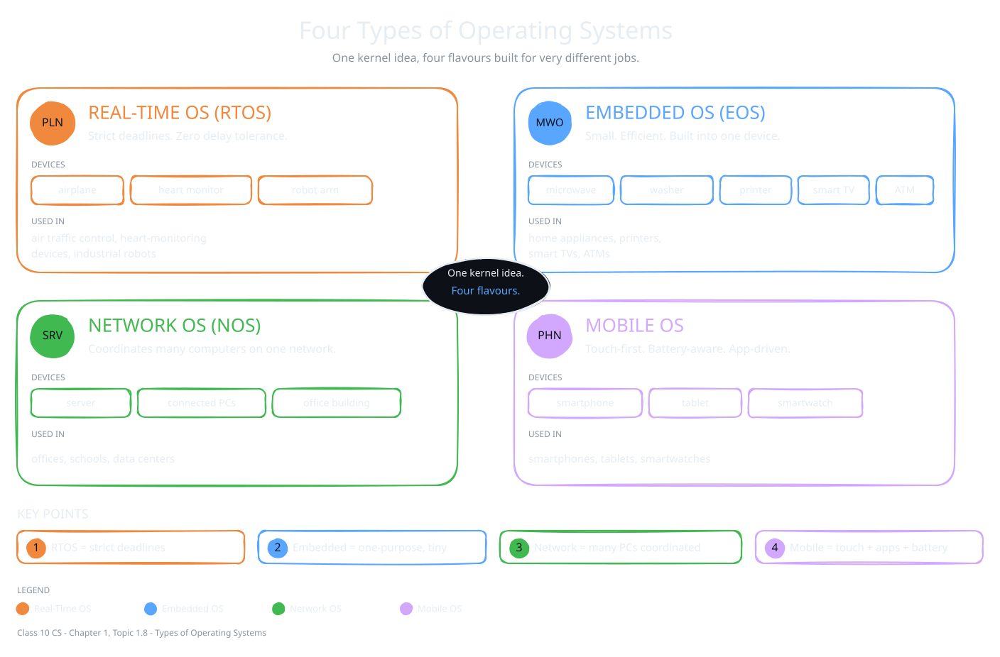

The OS inside a microwave is very different from the OS on your phone. Each device has different needs. So operating systems are built for the device and the work it does. Each type is tuned for its own job. In this topic, you will meet four types.

## Real-Time Operating System (RTOS)

Some systems cannot wait, not even for a moment. An RTOS must finish each task before a strict time limit, called a deadline. Here, even a tiny delay can cause a system failure or serious harm.

:::definition{source="Computer Science and Entrepreneurship 10 (PECTAA), topic 1.8"}
A **Real-Time Operating System** is designed to process data and respond within a strict time limit, known as a **deadline**.
:::

- **Key feature:** it handles each task as soon as it arrives, with no long waiting.
- **Used in:** air traffic control, heart-monitoring devices and industrial robots.

:::did-you-know
NASA's Mars rovers run VxWorks, a real-time operating system.
:::

## Embedded Operating System (EOS)

An embedded OS lives inside one device and does only what that device needs. It is not made for general computer work, like a laptop OS. It is made for one task or a few tasks.

:::definition{source="Computer Science and Entrepreneurship 10 (PECTAA), topic 1.8"}
An **Embedded OS** is a small and highly efficient operating system built into a specific device to control only the functions it needs.
:::

- **Key feature:** it uses very little memory and power. It is often stored permanently inside the device.
- **Used in:** microwaves, washing machines, printers, smart TVs and ATMs.

## Network Operating System (NOS)

A network OS connects many computers. It lets users share files, printers and internet connections. Windows MultiPoint Server is one example the book gives.

:::definition{source="Computer Science and Entrepreneurship 10 (PECTAA), topic 1.8"}
A **Network OS** manages and supports multiple computers connected through a network.
:::

- **Key feature:** it focuses on communication and teamwork between computers.
- **Used in:** offices, schools and data centers.

:::example
In your school computer lab, students sit at different computers. Yet all of them save files to the same server and print on the same printer. The network OS makes this possible.
:::

## Mobile Operating System

A mobile OS runs on devices you hold in your hand. It is built for touch screens, long battery life and mobile apps.

:::definition{source="Computer Science and Entrepreneurship 10 (PECTAA), topic 1.8"}
A **Mobile OS** is designed for smartphones, tablets, and other handheld devices. It is optimized for **touch-screen use**, **battery saving**, and **mobile apps**.
:::

- **Key feature:** it supports wireless connections, cameras, sensors and app stores.
- **Used in:** smartphones, tablets and smartwatches.

:::did-you-know
Early mobile operating systems, like Symbian on old Nokia phones, could run only a few small apps. Today, Android and iOS handle millions of apps, 3D games and even professional video editing tools.
:::

### The four types at a glance

| Type | Main focus | Used in |
|---|---|---|
| Real-Time OS | Meeting strict deadlines | Air traffic control, heart monitors, robots |
| Embedded OS | One device, small and efficient | Microwaves, printers, smart TVs, ATMs |
| Network OS | Sharing between many computers | Offices, schools, data centers |
| Mobile OS | Touch, battery and apps | Smartphones, tablets, smartwatches |
