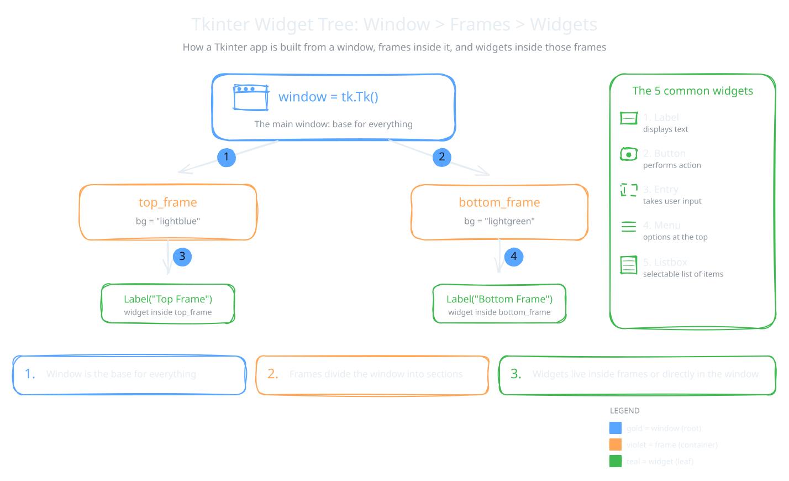

A Tkinter program is built like a house. The main window is the plot of land. Frames are the rooms. Widgets are the furniture inside each room.

In this topic you learn what widgets are, how frames divide a window, and the five common widgets the book names.

## Tkinter Components and Widgets

Tkinter gives you many ready-made parts for your program. These parts are called widgets.

:::definition{source="Computer Science 12 (PECTAA), topic 4.1b"}
Tkinter provides many components, called widgets, that help build interactive graphical applications.
:::

Each widget has one job. Some widgets let the user enter data. Some let the user choose an option. Others let the user perform an action, like saving or logging in. When you combine several widgets, you get a complete interface.

Tkinter can also arrange your widgets neatly on the screen. This is called layout management, and it is the next topic.

:::tip
Class activity from the book: "Create a main window and divide it into two frames. Add different widgets in each frame to organize layout." The example below shows exactly how to start.
:::

## Creating Windows and Adding Frames

Every Tkinter program starts with one main window. All other elements live inside it. You can resize the window, give it a title, and fill it with widgets.

:::definition{source="Computer Science 12 (PECTAA), topic 4.1b"}
Frames are sections within the window that help organize content.
:::

A frame is like a box inside the window. You put related widgets in the same frame. For example, all the buttons of a toolbar can share one frame. This keeps a big interface tidy and easy to read.



### Example

This program splits a window into a light blue top frame and a light green bottom frame.

```python
import tkinter as tk

# Create main window
window = tk.Tk()
window.title("Tkinter Frames Example")
window.geometry("400x300")

# Create top frame
top_frame = tk.Frame(window, bg="lightblue", height=100)
top_frame.pack(fill="x")

# Create bottom frame
bottom_frame = tk.Frame(window, bg="lightgreen", height=200)
bottom_frame.pack(fill="both", expand=True)

# Add widgets to top frame
label_top = tk.Label(top_frame, text="Top Frame", bg="lightblue")
label_top.pack(pady=20)

# Add widgets to bottom frame
label_bottom = tk.Label(bottom_frame, text="Bottom Frame", bg="lightgreen")
label_bottom.pack(pady=50)

# Run the application
window.mainloop()
```

How it works:

- `tk.Frame(window, ...)` creates a frame inside `window`. The first argument is always the parent, meaning the container the new widget goes into.
- `bg="lightblue"` sets the background colour. `height=100` asks for a frame 100 pixels tall.
- `top_frame.pack(fill="x")` stretches the top frame across the full width of the window.
- `bottom_frame.pack(fill="both", expand=True)` lets the bottom frame grow in both directions. It takes all the space that is left.
- `tk.Label(top_frame, ...)` puts the label inside `top_frame`, not directly in the window. The label uses the same `bg` colour, so it blends in.
- `pady=20` and `pady=50` add empty space above and below each label.

The result is a window titled "Tkinter Frames Example". The top part is light blue and shows "Top Frame". The bottom part is light green and shows "Bottom Frame".

The book's summary of this example:

- Tk() creates main window
- Frame divides window into sections
- top_frame and bottom_frame organize layout
- pack() places frames and widgets
- Frames help keep the GUI clean and well-structured

## Common Widgets: Labels, Buttons, Entry Fields, Menus, and List boxes

Widgets are the basic building blocks of any GUI. The book names five common ones:

| Widget | What it does (book wording) |
|---|---|
| Label | used to display text or messages on the screen |
| Button | allows the user to perform an action when it is clicked |
| Entry field | used to enter text, such as a name or password |
| Menu | provides a list of options at the top of the window |
| Listbox | shows a list of items and allows selection from the list |

:::example
Think of a login screen. A Label shows "Username". An Entry field lets you type it. A Button says "Login". The File and Edit options at the top of a program are a Menu. A list of saved contacts you can pick from works like a Listbox.
:::

:::did-you-know
Tkinter has more widgets than these five. A Checkbutton is a tick box. A Radiobutton lets you pick one option from a group. Text is a box for many lines. Scale is a slider, Canvas lets you draw shapes, and Toplevel opens a second window.
:::
