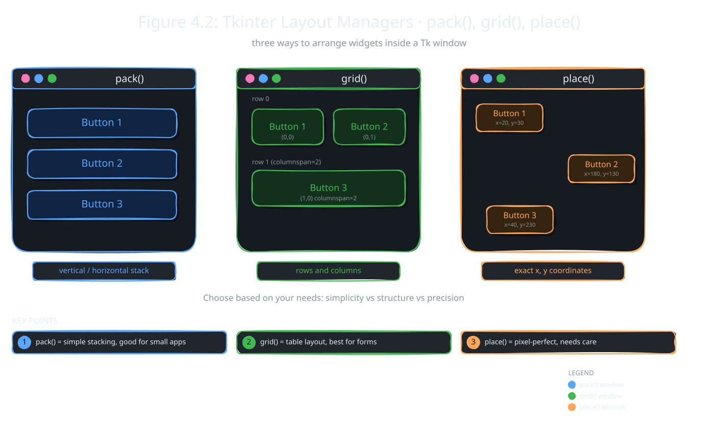

Making widgets is only half the job. You also have to decide where each one goes. A messy window is hard to use, even if every button works.

In this topic you meet Tkinter's three layout methods: pack(), grid() and place(). Each one arranges widgets in a different way.

## Layout Management

:::definition{source="Computer Science 12 (PECTAA), topic 4.1c"}
Layout management is used to arrange widgets inside a window in a proper way.
:::

Layout management decides two things for every widget: its position and its size. A good layout makes the window clear, organized and easy to use. Tkinter gives you three methods for this, and each places widgets in its own way.

:::did-you-know
The book's Tidbit: a proper layout makes an app look neat. It also helps the app work well on screens of different sizes.
:::

## Organizing Elements using pack(), grid(), and place()

Here is a quick look at the three methods before the code.

- **pack()** stacks widgets one after another, top to bottom or side by side. It is easy and good for small apps.
- **grid()** puts widgets in rows and columns, like a table. It is good for forms.
- **place()** puts each widget at an exact spot, using x and y positions. It gives full control, but you must adjust it carefully.



### Example pack():

```python
import tkinter as tk

# Create main window
window = tk.Tk()
window.title("pack()")
window.geometry("300x220")

# Create buttons
button1 = tk.Button(window, text="Button 1", width=12)
button2 = tk.Button(window, text="Button 2", width=12)
button3 = tk.Button(window, text="Button 3", width=12)

# Arrange buttons using pack()
button1.pack(pady=10)
button2.pack(pady=10)
button3.pack(pady=10)

# Run the application
window.mainloop()
```

The three buttons are created first. Nothing shows until you call `pack()`. Each `pack()` adds the button below the one before it. `pady=10` puts 10 pixels of space above and below each button. The result is three buttons stacked in a column.

### Example grid():

```python
import tkinter as tk

# Create main window
window = tk.Tk()
window.title("grid()")
window.geometry("300x220")

# Create buttons
button1 = tk.Button(window, text="Button 1", width=10)
button2 = tk.Button(window, text="Button 2", width=10)
button3 = tk.Button(window, text="Button 3", width=24)

# Arrange buttons using grid()
button1.grid(row=0, column=0, padx=10, pady=20)
button2.grid(row=0, column=1, padx=10, pady=20)

# Button 3 spans two columns
button3.grid(row=1, column=0, columnspan=2, padx=10, pady=10)

# Keep content centred
window.grid_columnconfigure(0, weight=1)
window.grid_columnconfigure(1, weight=1)

# Run the application
window.mainloop()
```

Rows and columns start counting at 0. Button 1 sits in row 0, column 0. Button 2 sits in row 0, column 1, so it is next to Button 1. Button 3 is in row 1. `columnspan=2` makes it stretch across both columns, which is why it is wider. `padx` adds space on the left and right. The two `grid_columnconfigure(..., weight=1)` lines tell both columns to share any extra width equally. That keeps the buttons centred.

### Example place():

```python
import tkinter as tk

# Create main window
window = tk.Tk()
window.title("place()")
window.geometry("300x220")

# Create buttons
button1 = tk.Button(window, text="Button 1", width=10)
button2 = tk.Button(window, text="Button 2", width=10)
button3 = tk.Button(window, text="Button 3", width=10)

# Arrange buttons using place()
button1.place(x=30, y=40)
button2.place(x=170, y=85)
button3.place(x=30, y=140)

# Run the application
window.mainloop()
```

Here you give exact pixel positions. `x` counts from the left edge of the window and `y` counts down from the top. So Button 1 is 30 pixels from the left and 40 pixels down. The buttons end up wherever you say, even in a zig-zag.

| | pack() | grid() | place() |
|---|---|---|---|
| Arranges by | simple vertical or horizontal order | rows and columns like a table | exact x, y positions |
| Best for | small applications | forms and structured layouts | pixel-exact details |
| Control | low | medium | high |

:::warning
Inside one parent, pick ONE method. Never mix pack() and grid() in the same window or frame. Tkinter may stop with an error, or even freeze while it tries to work out the positions.
:::

## Designing Clean and Responsive Interfaces

A clean window has well-arranged widgets with enough space between them. Text and buttons should be clear and easy to read. Good alignment makes the whole app look better, and a simple design is friendlier to use.

A responsive interface changes its layout when the user resizes the window. So the program still looks right on a small laptop or a large monitor.

:::tip
For responsive forms, use grid() with `weight=1`, as in the grid() example. Use place() only for small details. A whole window built with place() breaks when the user resizes it.
:::
