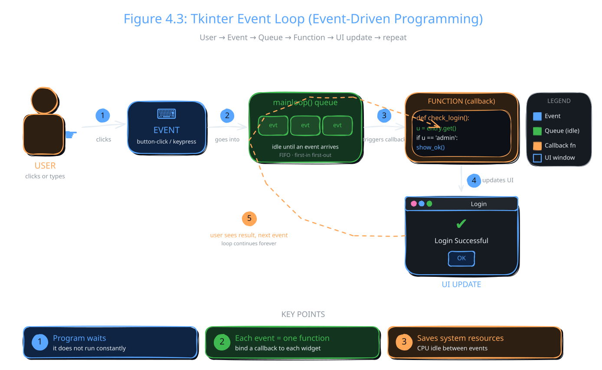

A GUI program does not run from top to bottom and then stop. It opens a window and waits. When you click or type, it reacts. This topic explains how that works, and ends with a working login form.

## Event Handling and Interactivity

Event handling lets a program respond to what the user does.

:::definition{source="Computer Science 12 (PECTAA), topic 4.1d"}
An event is an action, such as clicking a button or typing text.
:::

The program does not keep running all the time. It waits for an event. When an event happens, the program performs one specific task. This makes the application feel active and useful. Event handling is very important in GUI programs, because it controls how the program behaves.

## Understanding Event-Driven Programming

:::definition{source="Computer Science 12 (PECTAA), topic 4.1d"}
Event-driven programming is based on actions called events.
:::

In this style, the program stays idle until something happens. Common events are button clicks and key presses. Each event is linked to its own function. That function runs only when its event happens. Because the program is not busy all the time, this approach saves system resources. Almost every GUI works this way.



In Tkinter, `window.mainloop()` is the waiting part. It keeps watching for events. When one arrives, it calls the function you linked to it. A function that runs in reply to an event is often called a callback.

## Handling User Input and Connecting Widgets to Functions

Users give input through widgets, like entry fields and buttons. You connect a widget to a function in your code. When the user uses that widget, the connected function runs and processes the input. For example, a button click can show a message.

In Tkinter, you connect a button to a function with its `command` option. You saw this in topic 4.1a with `command=on_click`. Tkinter saves the function and calls it for you on every click.

:::warning
Write `command=check_login`, with no brackets. If you write `command=check_login()`, Python calls the function once, straight away, while it builds the button. Then the button does nothing when clicked.
:::

## Example: Simple Login Form

A login form asks for a username and a password. Two entry fields take the input, and a button submits it. When the button is clicked, the program checks the data. Then it shows a success or an error message.

```python
import tkinter as tk
from tkinter import messagebox

# Create main window
window = tk.Tk()
window.title("Login Form")
window.geometry("300x200")

# Function to check login
def check_login():
    username = entry_user.get()
    password = entry_pass.get()

    # simple check
    if username == "admin" and password == "1234":
        messagebox.showinfo("Success", "Login Successful!")
    else:
        messagebox.showerror("Error", "Invalid Username or Password")

# Username label and entry
tk.Label(window, text="Username").pack()
entry_user = tk.Entry(window)
entry_user.pack()

# Password label and entry
tk.Label(window, text="Password").pack()
entry_pass = tk.Entry(window, show="*")
entry_pass.pack()

# Login button
tk.Button(window, text="Login", command=check_login).pack(pady=10)

# Run application
window.mainloop()
```

How it works:

- `from tkinter import messagebox` loads Tkinter's pop-up message boxes.
- `check_login()` is the callback. It runs only when the Login button is clicked.
- `entry_user.get()` reads the text the user typed in the username box. `entry_pass.get()` does the same for the password.
- The `if` line checks if the username is "admin" and the password is "1234".
- If both match, `messagebox.showinfo()` shows a "Login Successful!" pop-up. If not, `messagebox.showerror()` shows "Invalid Username or Password".
- `tk.Label(window, text="Username").pack()` creates and places a label in one line. It needs no variable, because the code never changes it later.
- `show="*"` hides the password. Each typed letter appears as a star.
- `command=check_login` links the Login button to the check function.

Run it, type admin and 1234, and click Login. A "Success" box appears with an OK button.

The book's summary of this example:

- Entry takes username and password
- Button submits data
- check_login() checks input
- messagebox shows success or error
- Works on event-driven programming

:::tip
Class activity from the book: "Explain event-driven concepts and have students add a button that triggers a label update on click." Look back at the `on_click()` example in topic 4.1a for a starting point.
:::

:::warning
This form keeps the password inside the code only for teaching. Real apps never store plain passwords. They save a scrambled version, called a hash, using tools like bcrypt or argon2.
:::

:::did-you-know
`command` only handles clicks. With `.bind()`, a widget can react to other events too, such as `"<Key>"` for a key press. The same idea is used everywhere: web pages use `addEventListener('click', ...)` to react to clicks.
:::
