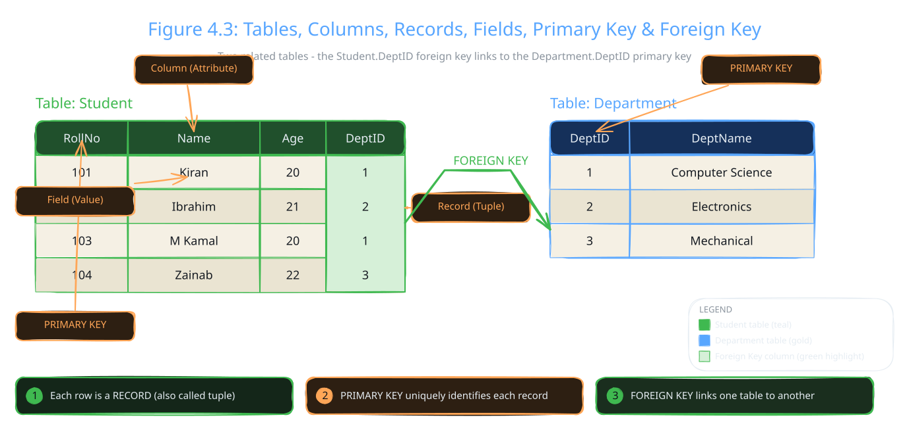

Programs need a place to keep their data, even after they close. A school app must remember every student. That place is a database.

This topic gives you the basic words of databases. You need them before you write any database code in the next topics.

## Working with Databases in Python

Python programs can connect to a database. Once connected, they can insert, retrieve, update and delete data. Databases handle large amounts of information well. They also keep data accurate and consistent. Python works with databases through built-in and external libraries.

:::did-you-know
The book's "Do You Know?" box: databases let programs store a lot of information safely, and find it again quickly when needed.
:::

## Introduction to Databases

:::definition{source="Computer Science 12 (PECTAA), topic 4.2a"}
A database is an organized collection of data stored in a structured format.
:::

Organized data is easy to find and manage. A database also cuts down on repeated copies of the same data. It makes storage more reliable and secure. That is why so many software applications use one.

Four words describe the contents of a database.

### Entity

:::definition{source="Computer Science 12 (PECTAA), topic 4.2a"}
An entity is a real-world object, person, place, event, or concept about which data is stored in a database.
:::

Examples from the book: Student, Teacher, Course, Book, Employee.

### Attribute

:::definition{source="Computer Science 12 (PECTAA), topic 4.2a"}
An attribute is a property or characteristic of an entity. It describes specific information about an entity.
:::

For the entity Student, the attributes can be Student Name, Roll Number, Class and Age.

### Relationship

:::definition{source="Computer Science 12 (PECTAA), topic 4.2a"}
A relationship shows how two or more entities are connected with each other.
:::

The book's example: a Student enrols in a Course. Here, "enrols in" is the relationship between Student and Course.

### Identifier

:::definition{source="Computer Science 12 (PECTAA), topic 4.2a"}
An identifier is an attribute that uniquely identifies each record or object of an entity.
:::

Roll Number is a good identifier for a Student. No two students share the same roll number.

## Understanding Databases

Applications keep their important data in databases. The book lists these key concepts:

- **Relational Database:** A database that stores data in tables (rows and columns) and links them using relationships.
- **Table:** A collection of related data organised in rows (records) and columns (fields).
- **Column:** A property or characteristic of an entity (e.g., name, age).
- **Primary Key:** A unique identifier for each record in a table.
- **Foreign Key:** A field that links one table to another by referring to the primary key of another table.

Figure 4.3 in the book shows all of these at once. It has a Student table and a Department table.

Each row of the Student table is one record, also called a tuple. Each column, like Name, is an attribute. One single cell, like "Kiran", is a field value. RollNo is the primary key of Student, because every roll number is different. DeptID is the primary key of Department.

Now look at DeptID inside the Student table. It is a foreign key. Kiran has DeptID 1. In the Department table, 1 means Computer Science. So Kiran studies Computer Science. The key links the two tables, so no department name is typed twice.

:::example
A table is like a sheet in Excel. Rows are records and columns are fields. The big difference: a database also checks data types and enforces keys and relationships.
:::

## Overview of Relational Databases and SQL Structure

A relational database keeps its data in tables of rows and columns. Each table holds one kind of related data. Keys keep the links between tables.

To talk to a relational database, you use SQL. SQL stands for Structured Query Language. Its commands let you create, read, update and delete data. You will run SQL from Python in the next two topics.

:::did-you-know
Many database systems use SQL. SQLite is a small, file-based one built into Python. MySQL and PostgreSQL run many bigger apps.
:::
