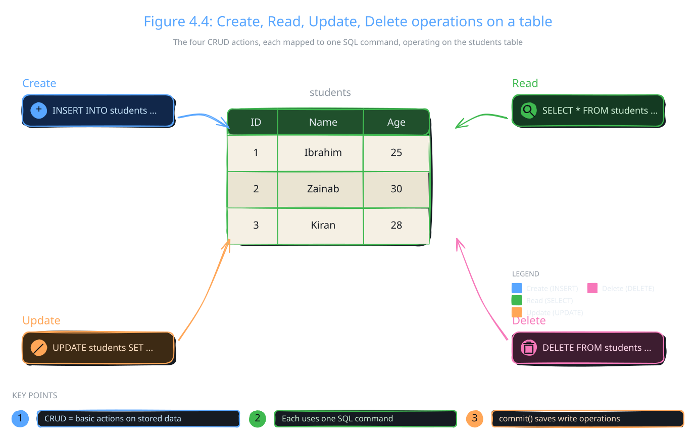

Every app that stores data adds it, shows it, changes it and removes it. These four actions have a short name: CRUD. This topic gives you the SQL command for each one.

## CRUD Operations

:::definition{source="Computer Science 12 (PECTAA), topic 4.2c"}
CRUD stands for Create, Read, Update, and Delete and defines basic database actions.
:::

CRUD is how you manage the data in a database. Every database app depends on it. These operations keep the stored information correct and up to date. Python performs them by sending SQL commands to the database.



Table 4.1 in the book matches each action to one SQL command:

| Command | Command Example | Description |
|---|---|---|
| INSERT | `INSERT INTO students (ID, Name, Age) VALUES (1, 'John', 20);` | Adds a new record to a table. |
| READ | `SELECT * FROM students;` | Retrieves data from a table. |
| UPDATE | `UPDATE students SET Age = 21 WHERE ID = 1;` | Modifies an existing record in a table. |
| DELETE | `DELETE FROM students WHERE ID = 1;` | Removes a record from a table. |

## Create: Adding New Records

Create adds new data to a table, such as a new student's name and age. It uses the SQL `INSERT` command. Python sends the command to the database. After it runs, the new record is part of the stored data.

```sql
INSERT INTO students (ID, Name, Age) VALUES (1, 'John', 20);
```

The first brackets list the columns. The second brackets give the values, in the same order.

:::tip
Trying this on the `school.db` from topic 4.2b? ID 1 already belongs to Ali, and a primary key cannot repeat. SQLite will refuse the row. Use an ID that is not taken yet, such as 10.
:::

## Read: Retrieving and Displaying Data

Read fetches data from the database so you can show it. It uses the SQL `SELECT` command. Python gets the results back and can then print or process them. Reading never changes the stored data.

```sql
SELECT * FROM students;
```

The `*` means "all columns". In Python, you then call `cursor.fetchall()` to get the rows as a list, as you did in topic 4.2b.

## Update: Modifying Existing Records

Update changes data that is already stored, for example to correct a mistake. It uses the SQL `UPDATE` command. The command runs on a condition, so only the chosen data changes.

```sql
UPDATE students SET Age = 21 WHERE ID = 1;
```

`SET` names the column and its new value. `WHERE` picks the row. Here, only the student with ID 1 gets the new age.

:::warning
An `UPDATE` without `WHERE` changes every row in the table. The same is true for `DELETE`: without `WHERE`, it removes every row. Always check your `WHERE` part first.
:::

:::tip
Class activity from the book: "Update a student's marks and display updated data." The `students` table from topic 4.2b has no marks column, so you can practise by updating `age` or `grade` instead. Run an `UPDATE`, call `commit()`, then run `SELECT * FROM students` to see the change.
:::

## Delete: Removing Data Safely

Delete removes data you no longer need. This keeps the database clean and accurate. The SQL `DELETE` command is used with a condition, so only the chosen records go. Careful use stops you from losing important data.

Here is the book's Python example:

```python
import sqlite3
# Connect to the database
connection = sqlite3.connect("school.db")
# Create a cursor object
cursor = connection.cursor()
# Execute DELETE query (example: delete student with ID = 1)
cursor.execute("DELETE FROM students WHERE ID = 1")
# Save changes
connection.commit()
# Display confirmation
print("Record deleted successfully")
# Close the connection
connection.close()
```

How it works:

- `sqlite3.connect("school.db")` opens the same database file you made in topic 4.2b.
- `connection.cursor()` creates the cursor that will carry the command.
- `cursor.execute("DELETE FROM students WHERE ID = 1")` removes only the student whose ID is 1.
- `connection.commit()` saves the change to the file.
- `print(...)` shows a confirmation message.
- `connection.close()` ends the connection.

If you ran the program from topic 4.2b first, the student with ID 1 is Ali. So Ali is the one removed.

The book's three key points about this code:

- `DELETE FROM students WHERE ID = 1` removes a specific record
- `connection.commit()` saves the changes in database
- Without `commit()`, deletion will not be permanent

:::did-you-know
CRUD is everywhere, not just in SQL. Web services use the same four ideas: POST creates, GET reads, PUT or PATCH updates, and DELETE deletes.
:::
